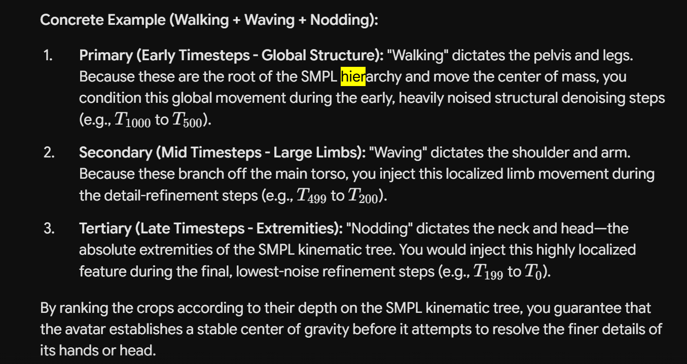

# Optimizing Part-Wise-Composition-of-Human-Motion
In the original paperMulti-Track Timeline Control for Text-Driven 3D Human Motion Generation with repository: nv-tlabs/stmc:
- Multi-Track Timeline Control. 
- leveraging a Pretrained MDM-SMPL diffusion model to create Motion generation/composition.
- Motion generation from multiple action instructions.
- Body-part-specific motion composition.
- MTT benchmark.
- Existing SINC-style baselines.
- Evaluation scripts and visualization

### Our proposed idea is Leveraging the same motion diffusion models  (MDM) and investigate whether changing the stitching schedule during the denoising process has and effect on the results Does it give smoother motion?: 

2. Initially allow the model to establish a globally coherent body pose. by must rank your 3+  motion crops by how much they impact the body's center of mass. and that's is how you eleminalte the effect of the order of the movement of the body parts in the timeline, we establish a hierarchy staggering their introduction based on physical hierarchy rather than injecting them all at once

3. stitching schedule aparoaches:

    - (Late stitching: Start composition only in later denoising steps.) 
Hierarchical Timestep Scheduling: Because early diffusion timesteps (heavy noise) dictate the global structure and later timesteps (low noise) refine high-frequency details, you must rank your 3+ crops by how much they impact the body's center of mass. To prevent the multiple conditions from fighting for structural dominance, the foundational global movement (e.g., walking or jumping) would dictate the earliest, heavily noised structural denoising steps. Secondary and tertiary localized limb movements (e.g., waving an arm, then kicking a leg) would be staggered and injected sequentially only during the later detail-refinement steps 

The SMPL model provides the hardcoded physical map, but you must actively calculate the ranking of your specific crops to determine when to inject them.Here is how the model's hierarchy and your crop calculations interact to create the schedule:

The SMPL Built-in Hierarchy (The Map): The SMPL model explicitly defines a strict "kinematic tree." At the absolute base of this tree is the pelvis (the root joint), which acts as the body's physical center of mass. Every other joint is a "child" or "grandchild" radiating outward from the pelvis (e.g., Pelvis $\rightarrow$ Spine $\rightarrow$ Collarbone $\rightarrow$ Shoulder $\rightarrow$ Elbow $\rightarrow$ Wrist).

Ranking the Crops (The Calculation): You cannot just feed actions into the model randomly. Because early diffusion timesteps dictate the global structure of the pose, you must rank your 3+ motion crops based on how heavily they dictate the movement of that SMPL root joint (the center of mass).

The Execution (Timestep Scheduling): You combine the map and the calculation. You evaluate which SMPL joints are required for each of your textual crops, measure how close those joints are to the root pelvis, and stagger their introduction into the diffusion loop based on that distance.

    - Progressive stitching : Gradually increase the composition influence.Gradually introduce the individual body-part constraints during the denoising process.
Progressive Spatial Masking: Instead of a single mask shift, you would continuously and dynamically shift the attention masks across the specific SMPL joints for each distinct movement as the diffusion process steps forward. This allows the multiple isolated latent features from the different crops to smoothly blend into the global motion one by one without structural interference.

    
   What the autoresearch loop should (and shouldn’t) do

Automate:
- Sweep schedule parameters: switch step, ramp shape, order, pair, seed.
- Generate motions, compute metrics, log everything, and produce a summary table or plot.
- Propose the next batch of configs, and flag anomalies (NaNs, foot-skate spikes). 
An agent that edits the pipeline or the metrics on its own is where this goes wrong. Let it change configs only, never code.
    
    
    
4. experiment with adaptive part stitching where we Train a neural network to predict optimal stitching schedules using karpathy auto-research loop (where it experiments with different aproachs and stitching schedules to improve benchmarks)

4. Compare the different stitching aproaches with the original method, which combines body-part predictions throughout denoising.
5. Evaluate whether the resulting motion is smoother and retains both intended movements.
This is particularly interesting because the authors of STMC explicitly identify their body-part stitching strategy as a limitation and suggest a more sophisticated stitching schedule as a potential improvement. 
